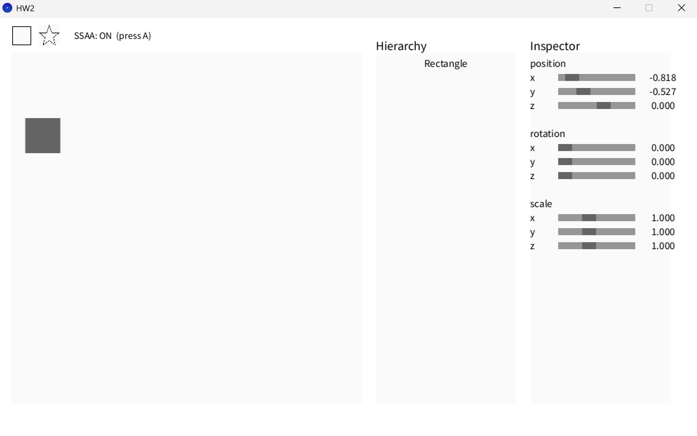
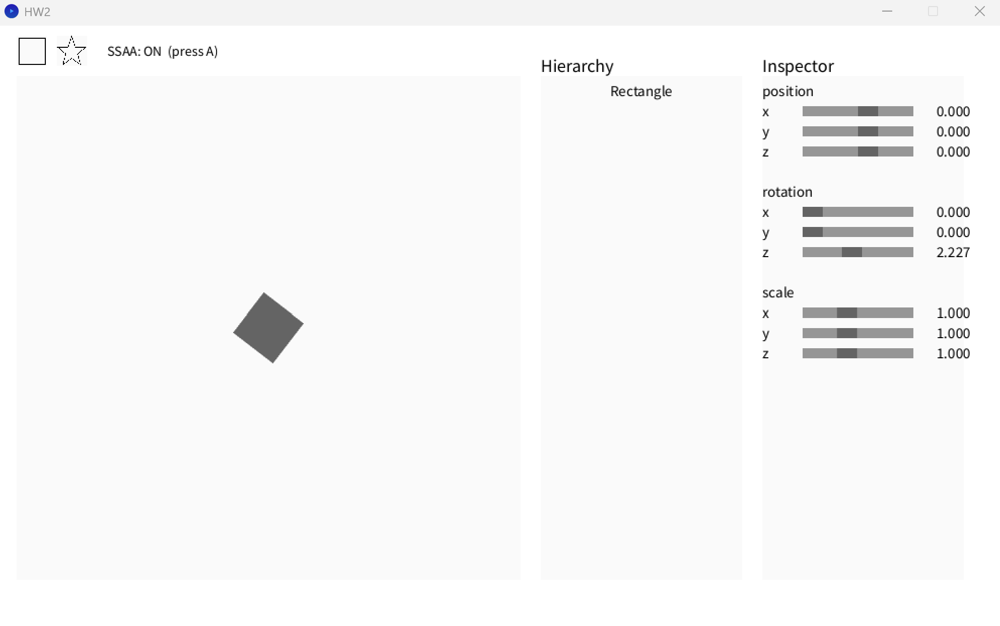
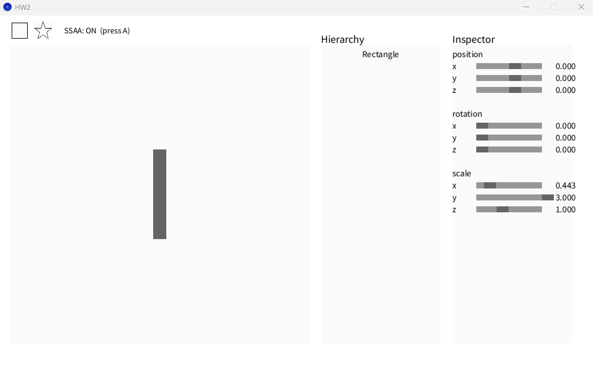
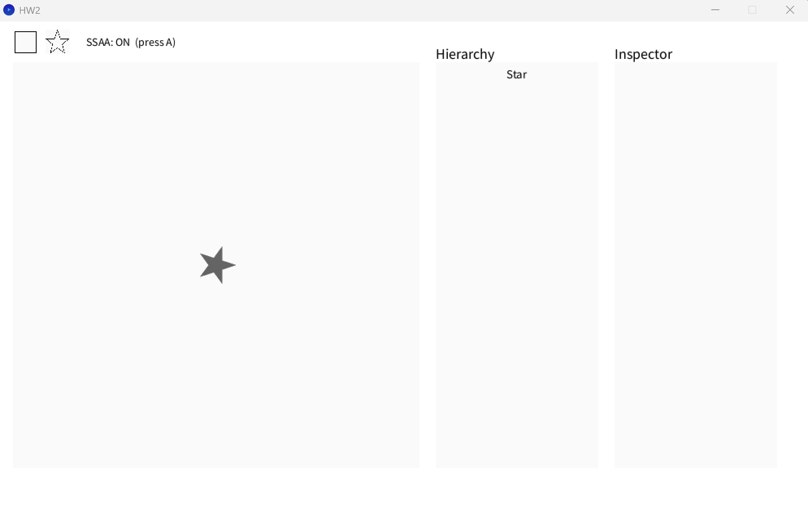
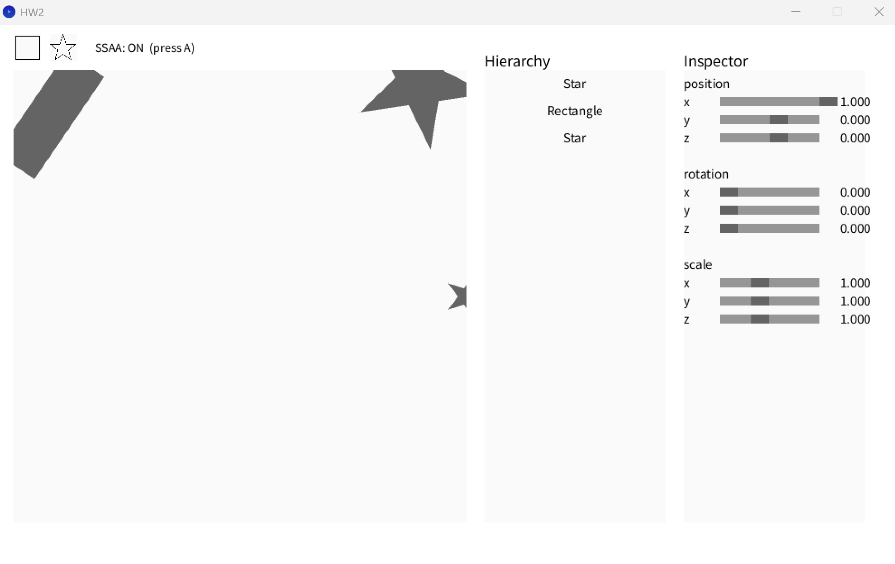
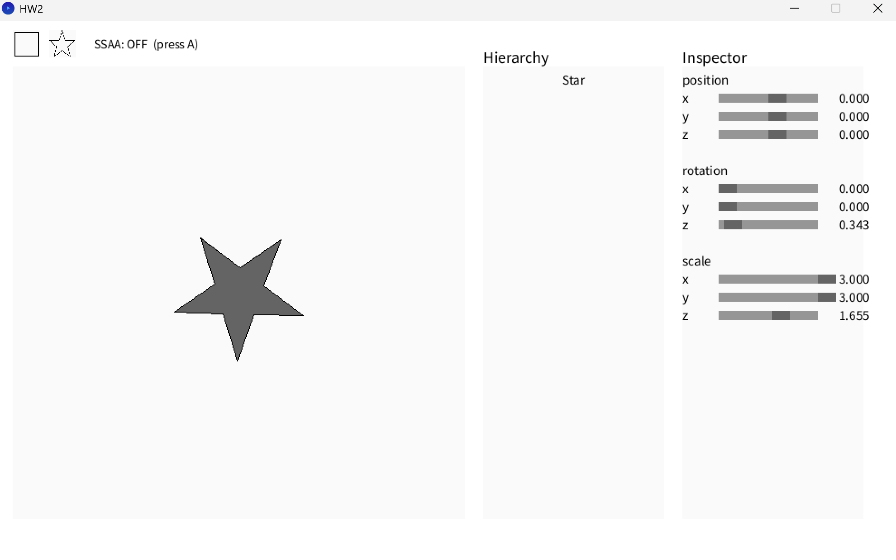
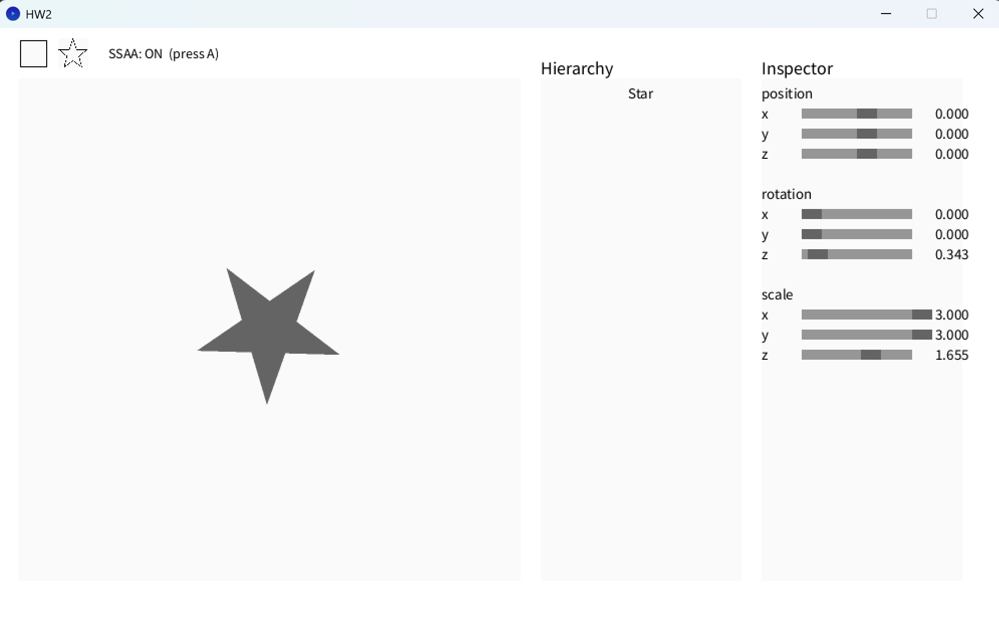

# CG Lab 2 — 2D Rasterization Engine

> 學號：`112502024`　姓名：`張凱翔`

## 完成項目

- [✅] Translation Matrix
- [✅] Rotation Matrix (Z-axis)
- [✅] Scaling Matrix
- [✅] Is the point inside a shape?
- [✅] Find the boundary of a polygon
- [✅] Keep the polygon inside the canvas
- [✅] Bonus: SSAA

---

## 1. 變換矩陣（Translation / Rotation / Scale）

### 截圖





### 做法

從 `MulPoint` 的寫法（`x' = m[0]x + m[1]y + m[2]z + m[3]`）可以看出，`Matrix4` 是**列優先**排列，所以平移量要放在 `m[3]`、`m[7]`、`m[11]`。三個函式都先呼叫 `makeIdentity()`，再修改需要的元素。

```java
void makeRotZ(float a) {
    makeIdentity();
    m[0] = cos(a);  m[1] = -sin(a);
    m[4] = sin(a);  m[5] =  cos(a);
}

void makeTrans(Vector3 t) {
    makeIdentity();
    m[3] = t.x;  m[7] = t.y;  m[11] = t.z;
}

void makeScale(Vector3 s) {
    makeIdentity();
    m[0] = s.x;  m[5] = s.y;  m[10] = s.z;
}
```

### 發現

- `localToWorld()` 是 `T * Rz * S`。矩陣從右往左作用，所以圖形會先在原點縮放、旋轉，最後才平移。如果順序反過來，圖形會繞著畫布原點轉，而不是繞著自己的中心轉。
- 螢幕座標的 y 軸朝下，所以 rotation z 增加時，畫面上看起來是**順時針**旋轉。

---

## 2. 包圍盒（findBoundBox）

### 做法

把所有頂點掃一遍，記錄 x、y 的最小值和最大值，回傳左上角 `(minX, minY)` 和右下角 `(maxX, maxY)`。填色時只需要檢查這個矩形裡的像素，不用掃整個畫面。

```java
float minX = v[0].x, minY = v[0].y, maxX = v[0].x, maxY = v[0].y;
for (int i = 1; i < v.length; i++) {
    minX = min(minX, v[i].x);  minY = min(minY, v[i].y);
    maxX = max(maxX, v[i].x);  maxY = max(maxY, v[i].y);
}
```

### 發現

- 原本的寫死範圍 (0,0)~(999,999) 每一幀要對約 100 萬個點呼叫 `pnpoly`，改用包圍盒之後只剩圖形附近的幾千個點。
- 圖形被完全裁掉時，頂點陣列是空的。這時回傳 min > max 的空範圍，讓填色迴圈一次都不執行，避免存取 `v[0]` 時當掉。

---

## 3. 點是否在多邊形內（pnpoly）

### 截圖



### 做法：射線法（Jordan 曲線定理）

從點 (x, y) 往右發出一條水平射線，計算它和多邊形的邊相交幾次：奇數次代表點在多邊形內，偶數次代表在外。這個方法對凹多邊形（例如星形）也成立。

```java
boolean inside = false;
for (int i = 0, j = n - 1; i < n; j = i++) {
    Vector3 a = vertexes[i], b = vertexes[j];
    if (((a.y > y) != (b.y > y)) &&
        (x < (b.x - a.x) * (y - a.y) / (b.y - a.y) + a.x))
        inside = !inside;
}
return inside;
```

### 發現

- `(a.y > y) != (b.y > y)` 已經保證 `a.y != b.y`，所以後面的除法不會除以 0。
- 射線剛好通過頂點時，這個寫法等於把頂點當成「稍微在射線上方」，所以不會重複計算。

---

## 4. Sutherland-Hodgman 裁切

### 截圖



### 做法

裁切框（畫布，在 NDC 座標 -1~1）有 4 條邊，就用每條邊輪流去切多邊形，每一輪的輸出就是下一輪的輸入。每一輪沿著多邊形的每條邊 S→E，依照兩個端點在裁切線的內側還是外側決定輸出：

| S | E | 輸出 |
|---|---|---|
| 內 | 內 | E |
| 內 | 外 | 交點 |
| 外 | 內 | 交點、E |
| 外 | 外 | 無 |

**判斷內外**用 2D 外積 `cross(B−A, P−A)` 的正負號。為了不依賴裁切框頂點是順時針還是逆時針，先算裁切框的有號面積 `orient`，外積和面積同號就代表在內側。

**交點**：令 `cS = cross(B−A, S−A)`、`cE = cross(B−A, E−A)`，則 `t = cS / (cS − cE)`，交點 = `S + t(E − S)`。

```java
float orient = signedArea(boundary);
for (int k = 0; k < boundary.length; k++) {
    Vector3 A = boundary[k], B = boundary[(k + 1) % boundary.length];
    output = new ArrayList<Vector3>();
    if (input.size() == 0) break;
    Vector3 S = input.get(input.size() - 1);
    for (Vector3 E : input) {
        boolean eIn = cross2D(A, B, E) * orient >= 0;
        boolean sIn = cross2D(A, B, S) * orient >= 0;
        if (eIn) {
            if (!sIn) output.add(intersect(A, B, S, E));
            output.add(E);
        } else if (sIn) {
            output.add(intersect(A, B, S, E));
        }
        S = E;
    }
    input = output;
}
```

### 發現


- S 從最後一個頂點開始，才會處理到「最後一點連回第一點」那條邊。
- 呼叫交點函式時，S、E 一定一內一外，cS、cE 異號，所以分母不會是 0。

---

## Bonus：SSAA（2×2 Super-Sampling Anti-Aliasing）

### 截圖

| SSAA OFF | SSAA ON |
|---|---|
|  |  |

### 做法

1. 每個像素切成 2×2 個子格，樣本取在子格中心（像素內偏移 0.25、0.75）。
2. 開一個大小為 `width × height × 4` 的樣本緩衝區。**每個樣本都有自己的顏色和深度**，不和相鄰像素共用。
3. 每一幀依序執行：
   - `clearSamples`：所有樣本清成背景色，深度設成無限遠。
   - 每個圖形對包圍盒內每個像素的 4 個樣本點呼叫 `pnpoly`，在內側就用 `writeSample` 寫入。寫入時會做深度測試：深度取 `transform.position.z`，數值越小越前面。
   - `resolveSamples`：把每個像素的 4 個樣本 RGB 取平均，寫回 `pixels[]`。

```java
// Shape::drawShape（SSAA 模式）
for (int sy = 0; sy < SS; sy++)
    for (int sx = 0; sx < SS; sx++)
        if (pnpoly(i + sampleOffset(sx), j + sampleOffset(sy), t_pos))
            writeSample(i, j, sy * SS + sx, depth, fillColor);

// writeSample：每個樣本獨立做深度測試
if (depth <= sampleDepth[k]) { sampleDepth[k] = depth; sampleColor[k] = c; }
```

### 發現

- 如果每個圖形各自把覆蓋率混進目前的畫面，兩個圖形共用的邊會混到兩次背景色，產生不正常的黑邊或白邊。先把所有圖形畫進樣本，最後統一取平均，就不會有這個問題。
- 深度測試用 `<=`：z 相同時後畫的圖形在上面，和沒開 SSAA 時的行為一致。調整 position z 可以改變圖形的前後順序。
- SSAA 模式不畫 CGLine 外框，因為外框是逐像素畫的，會重新帶來鋸齒。

---

## 其他問題與解法

- **螢幕位置錯亂**：Windows 開 200% 縮放時，Processing 預設 `pixelDensity` 為 2，`pixels[]` 實際大小變成 2000×1200。但 `drawPoint` 用 `y * width + x`（width = 1000）計算索引，所以圖形在 x 方向被壓成 1/2、y 方向被壓成 1/4。在 `setup()` 加上 `pixelDensity(1)` 後解決。


---

## LLM 使用說明

本次作業使用 Claude作為學習輔助，主要以一步一步引導的方式進行。

由claude提出思路及簡約程式碼框架，由我撰寫完成後測試，如果遇到問題再向AI求助解決方法，並在實作過程中釐清觀念。